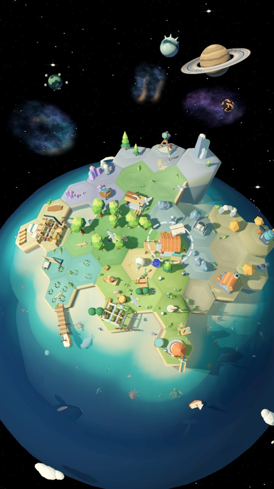
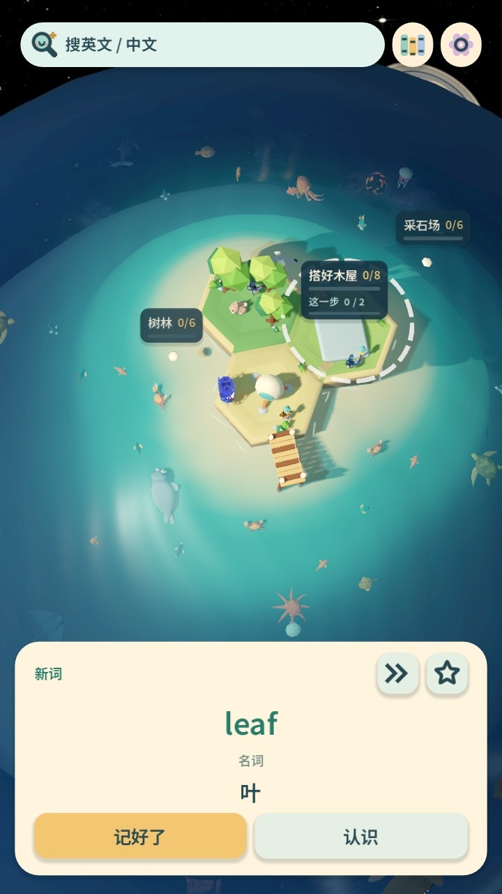
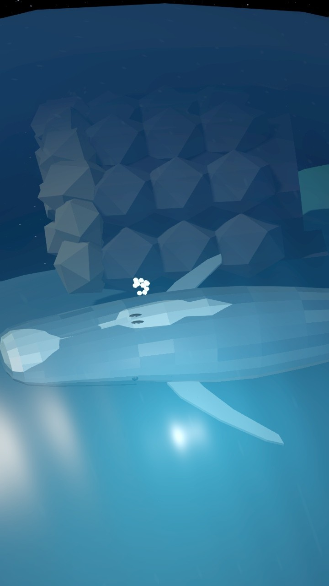
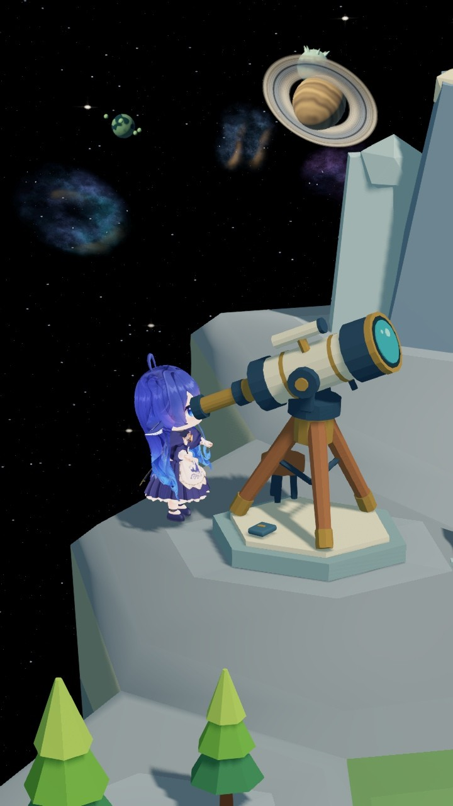
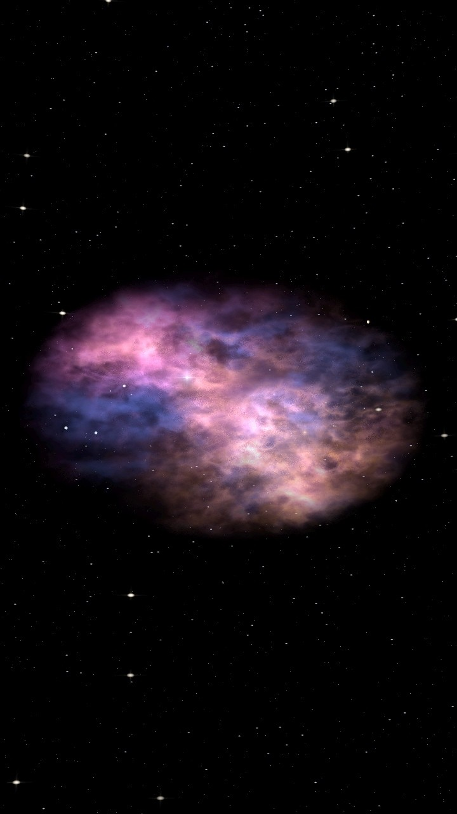
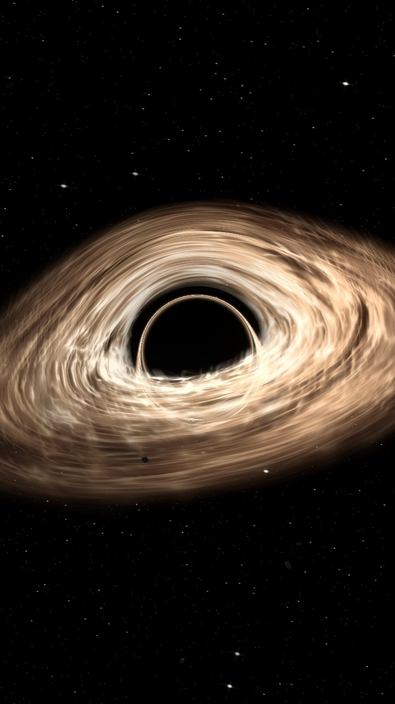

# ARWORD

在一颗小星球上背英语单词。记住几个词，去看看大肥鱼把木料搬到了哪里。住得久了，岸边会有木屋、船坞，山上还会多一架望远镜。

**[下载安卓版](https://github.com/Changxichengxian/ARWORD/releases/latest)** · [历次更新](https://github.com/Changxichengxian/ARWORD/releases)

  
  
  

点工地打开词卡，点英文可以听发音。收起卡片，两指转动小星球，就能看小动物在干什么。学习记录保存在本机。

  
  
  

山顶观星台建好后，点望远镜看星云，也可以直接点天空里的黑洞近看。拖动能绕着它看，双指张合能调远近。

安卓 7.0 或更高版本，需要支持 OpenGL ES 3.0。已经安装的用户可以在「设置 → 检查更新」下载新版。[角色署名和许可](source/assets/characters/whale-girl-CREDITS.txt)
